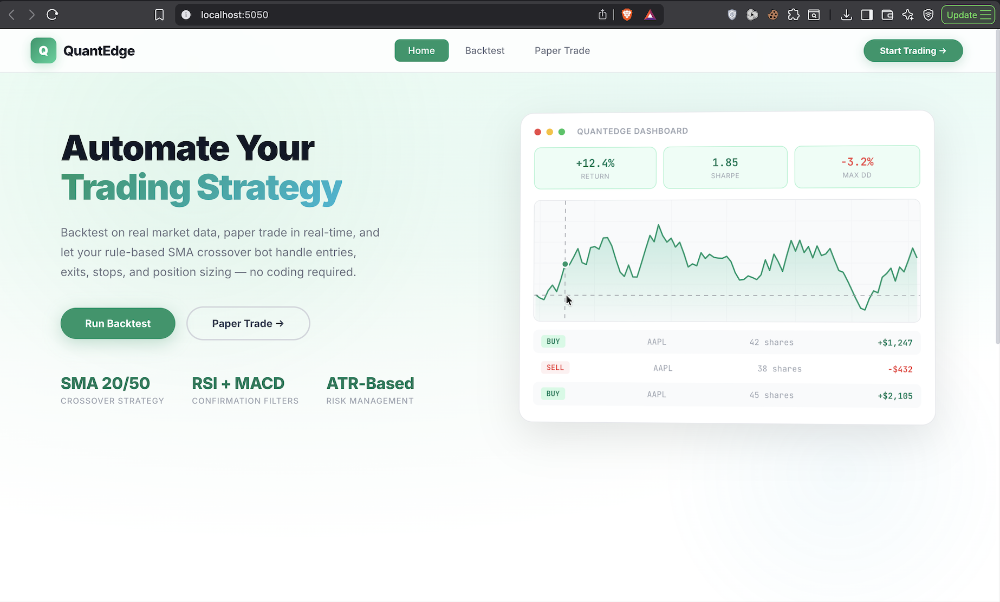
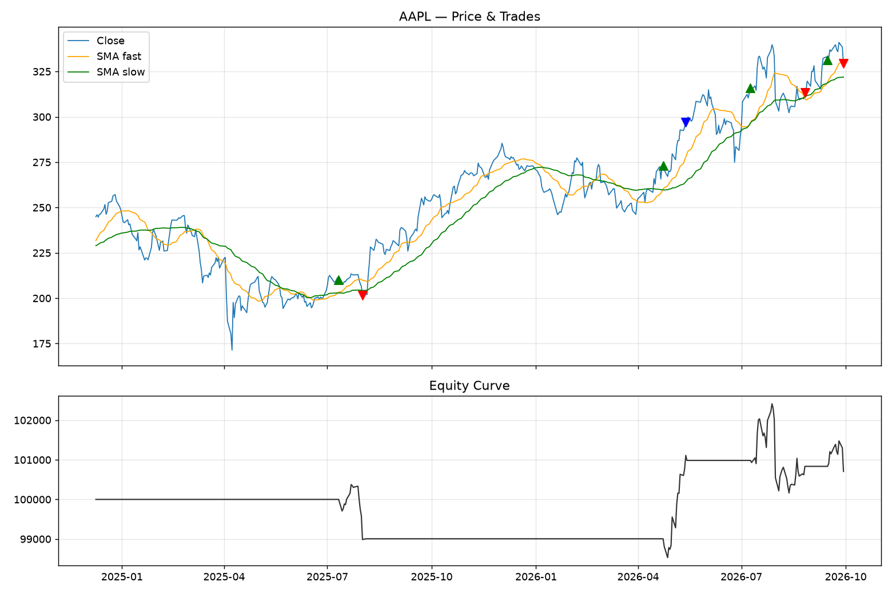

<p align="center">
  
</p>

<h1 align="center">QuantEdge — Algorithmic Trading Bot</h1>

<p align="center">
  <strong>Rule-based trend-following strategy with backtesting, paper trading, and a real-time web dashboard.</strong>
</p>

<p align="center">
  
  
  
  
  
</p>

---

## ✨ Features

| Feature | Description |
|---|---|
| 📊 **Historical Backtesting** | Bar-by-bar simulation on real Yahoo Finance data or synthetic random walks |
| 📡 **Paper Trading** | Live execution loop with a local simulator or Alpaca paper account |
| 🌐 **Web Dashboard** | Beautiful green & white UI with TradingView charts, metrics, and live logs |
| 🛡️ **Risk Management** | ATR-based stops, reward:risk targets, position limits, daily loss circuit breaker |
| ⚙️ **Fully Configurable** | Tune every parameter from the web dashboard — no code changes needed |
| 📈 **Interactive Charts** | TradingView Lightweight Charts with trade markers, equity curves, RSI overlays |
| 🔌 **Alpaca Integration** | Connect to a real Alpaca paper/live account with API keys |
| 🧪 **Synthetic Data** | Test the engine offline with a generated random-walk price series |

---

## 🖥️ Dashboard Preview

The web dashboard provides a complete trading interface:

- **Home** — Strategy overview, feature cards, and quick-start buttons
- **Backtest** — Configure symbol/period/strategy, run backtests, see big P&L results, interactive charts, and a full trade log
- **Paper Trade** — Start/stop a live trading loop, monitor in a real-time terminal, view order history

<p align="center">
  
  <br/>
  <em>Backtest output — Price chart with SMA overlays, trade markers, and equity curve</em>
</p>

---

## 🧠 Strategy

**Long-only trend-following** using SMA crossover confirmed by RSI and MACD momentum:

### Entry Conditions (all must be true)
- ✅ Fast SMA(20) crosses **above** Slow SMA(50)
- ✅ RSI(14) < 70 — not overbought
- ✅ MACD(12,26,9) histogram > 0 — positive momentum

### Exit Conditions (any one triggers)
- 🔴 Fast SMA crosses **below** Slow SMA
- 🔴 RSI > 75 — take profit into strength
- 🔴 ATR-based **stop-loss** hit
- 🔴 ATR-based **take-profit** target hit

All indicators are hand-implemented in [`core/indicators.py`](core/indicators.py) — no TA-Lib dependency.

---

## 🛡️ Risk Management

The [`RiskManager`](core/risk_manager.py) applies identical rules in both backtest and live trading:

| Parameter | Default | Description |
|---|---|---|
| `risk_per_trade_pct` | 1% | Percentage of equity risked per trade |
| `atr_stop_multiplier` | 2.0 | Stop-loss = entry − ATR × multiplier |
| `reward_risk_ratio` | 2.0 | Take-profit = stop distance × ratio |
| `max_position_pct` | 25% | Maximum % of equity in a single position |
| `max_daily_loss_pct` | 3% | Halt all new entries if breached |
| `max_open_positions` | 1 | Max concurrent open positions |

**Position sizing formula:**
```
risk_amount = equity × risk_per_trade_pct
stop_distance = ATR × atr_stop_multiplier
shares = min(risk_amount / stop_distance, max_position_notional / price)
```

---

## 📁 Project Structure

```
trading_bot/
├── config.py                  # All tunable parameters (strategy, risk, broker)
├── main.py                    # CLI entry point: backtest / paper
├── requirements.txt           # Python dependencies
├── .env.example               # Alpaca API keys template
│
├── core/
│   ├── indicators.py          # SMA, EMA, RSI, MACD, ATR (pure pandas/numpy)
│   ├── data_handler.py        # Yahoo Finance fetch + synthetic data generator
│   ├── strategy.py            # Signal generation (entry/exit logic)
│   ├── risk_manager.py        # Position sizing, stops, daily loss limit
│   ├── backtester.py          # Bar-by-bar simulation engine + metrics
│   ├── report.py              # Matplotlib chart + console metrics
│   └── logger.py              # Structured logging (file + stdout)
│
├── execution/
│   └── broker.py              # PaperBroker (local sim) / AlpacaBroker (live)
│
├── web/
│   ├── app.py                 # Flask web server + REST API + Socket.IO
│   └── templates/
│       └── index.html         # Single-page dashboard (HTML/CSS/JS)
│
├── logs/
│   ├── trading_bot.log        # Application logs
│   ├── backtest_report.png    # Last backtest chart (matplotlib)
│   └── paper_state.json       # Persisted paper broker state
│
└── docs/
    └── dashboard_screenshot.png
```

---

## 🚀 Quick Start

### 1. Install dependencies

```bash
pip install -r requirements.txt
```

### 2. Launch the web dashboard

```bash
python3 web/app.py
```

Open **http://localhost:5050** in your browser.

### 3. Or use the CLI

```bash
# Backtest with real Yahoo Finance data
python main.py backtest --symbol AAPL --period 2y --interval 1d

# Backtest with synthetic data (no network needed)
python main.py backtest --synthetic --synthetic-bars 750

# Paper trade with local simulator
python main.py paper --symbol AAPL --broker paper

# Paper trade with Alpaca (set API keys in .env first)
python main.py paper --symbol AAPL --broker alpaca
```

---

## 🔧 Configuration

All parameters live in [`config.py`](config.py) and can be overridden via the web dashboard:

### Strategy Parameters
```python
fast_sma = 20        # Fast moving average window
slow_sma = 50        # Slow moving average window
rsi_period = 14      # RSI lookback period
rsi_overbought = 70  # RSI threshold for entry filter
macd_fast = 12       # MACD fast EMA
macd_slow = 26       # MACD slow EMA
macd_signal = 9      # MACD signal line EMA
atr_period = 14      # ATR lookback for volatility
```

### Alpaca Setup (optional)
```bash
cp .env.example .env
# Edit .env with your Alpaca API keys
```

```env
ALPACA_API_KEY=your_key_here
ALPACA_SECRET_KEY=your_secret_here
ALPACA_PAPER=true
```

---

## 📊 Backtest Metrics

When you run a backtest (via CLI or dashboard), you get:

| Metric | Description |
|---|---|
| **Total Return** | Percentage gain/loss from initial capital |
| **CAGR** | Compound Annual Growth Rate |
| **Sharpe Ratio** | Risk-adjusted return (annualized) |
| **Max Drawdown** | Largest peak-to-trough decline |
| **Win Rate** | Percentage of profitable trades |
| **Profit Factor** | Gross profit ÷ gross loss |
| **Final Equity** | Portfolio value at end of period |

---

## 🔌 API Endpoints (Web Dashboard)

The Flask server exposes these REST endpoints:

| Endpoint | Method | Description |
|---|---|---|
| `/` | GET | Dashboard web page |
| `/api/backtest` | POST | Run a backtest with JSON config |
| `/api/quote?symbol=AAPL` | GET | Fetch latest quote for a symbol |
| `/api/paper/start` | POST | Start paper trading loop |
| `/api/paper/stop` | POST | Stop paper trading loop |
| `/api/paper/status` | GET | Get paper trading status & logs |

---

## 🧩 Extending

- **Add a new strategy** — Copy `core/strategy.py`'s `generate_signals()` function. Return a DataFrame with a `signal` column (1 = buy, -1 = sell, 0 = hold). The backtester and live loop don't care how signals are computed.

- **Add short selling** — Current logic is long-only by design. Extend `RiskManager` and the backtester to handle negative share counts.

- **Swap data source** — Replace `core/data_handler.py`'s `fetch_ohlcv()`. Everything downstream only needs columns: `open`, `high`, `low`, `close`, `volume`.

- **Add more indicators** — Add functions to `core/indicators.py`. They're pure pandas/numpy, no external library needed.

---

## ⚠️ Disclaimer

This is a **research and education project**, not financial advice. Backtest results do not guarantee future performance. Always test thoroughly on paper before connecting to a live account. Trade at your own risk.

---

<p align="center">
  Built with Python, Flask, and TradingView Lightweight Charts
</p>
